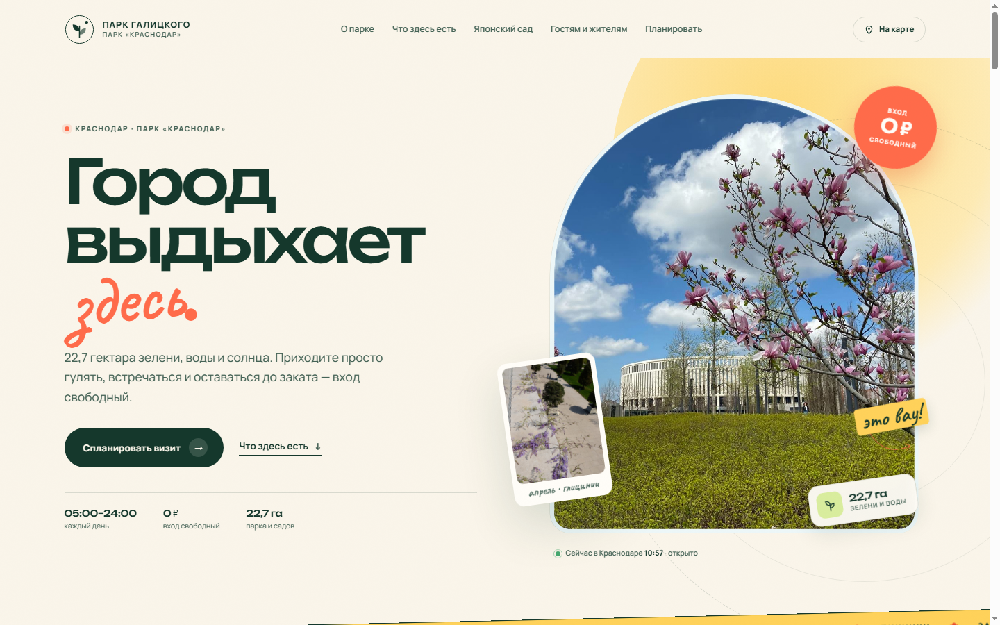

# Парк Галицкого — промо-лендинг

Яркий одностраничный сайт о парке «Краснодар» (парке Галицкого): приглашение
для гостей города и жителей, Японский сад, возможности парка, маршрут первого
визита и практическая информация.



## Живая версия

Сайт опубликован через GitHub Pages:

**https://sergeyeideman-design.github.io/galitsky-park/**

Репозиторий: **https://github.com/sergeyeideman-design/galitsky-park**

## Как открыть

Сайт статический и работает без сборки. Достаточно открыть `index.html` в
браузере — шрифты встроены в CSS, поэтому `file://` тоже работает.

Если хочется открыть через локальный сервер:

```powershell
python -m http.server 4173
# затем http://127.0.0.1:4173/
```

## Что реализовано

- адаптивная вёрстка для 320, 390, 768, 1024 и 1440 px;
- цепляющий первый экран с фотографией, «стикерами» и живым статусом парка;
- блок фактов о парке, bento-сетка возможностей, отдельный блок Японского сада;
- переключатель «Гостям / Жителям» с разными сценариями визита;
- маршрут первого посещения на 2–3 часа;
- режим работы, адрес, транспорт, парковка, правила;
- FAQ на нативных `details` и фотографии с лицензиями в подвале;
- мобильное меню с focus trap, клавиатурная навигация по табам, плавные
  появления блоков и поддержка `prefers-reduced-motion`;
- все изображения и шрифты локальные, без внешних библиотек и трекеров.

## Структура

```text
.
├── index.html
├── styles.css
├── script.js
├── assets/
│   ├── favicon.svg
│   ├── fonts.css          # @font-face с встроенными data URI
│   ├── fonts/             # исходные woff2 + тексты лицензий
│   └── img/               # оптимизированные фотографии
├── preview/
│   ├── desktop.png
│   └── mobile.png
└── README.md
```

## Источники и данные

Информация собрана из открытых источников и актуальна на октябрь 2026 года:

- [О парке Галицкого в вопросах и ответах](https://galitskypark.ru/obekty/o-parke-galickogo-v-voprosax-i-otvetax/) — площадь, режим работы, транспорт, правила, инфраструктура;
- [Японский сад отмечает трёхлетие](https://bloknot-krasnodar.ru/news/portal-v-aziyu-yaponskiy-sad-galitskogo-otmechaet-) — 7 га, 3,5 км троп, дата открытия;
- [Телеканал «Краснодар»: QR-коды в Японский сад](https://tvkrasnodar.ru/obshchestvo/2025/02/13/zloumyshlenniki-vnov-nachali-prodavat-qr-kody-v-yaponskiy-sad-krasnodara/) — бесплатные QR-коды и правила входа;
- [RUSSPASS: парк Галицкого](https://russpass.ru/place/64d4bee6f8df5634c5d03119).

Фотографии — Wikimedia Commons, авторы и лицензии указаны в подвале сайта
(раскрывающийся блок «Фотографии и лицензии»). Шрифты Unbounded, Manrope и
Caveat распространяются по SIL Open Font License 1.1; тексты — в
`assets/fonts/LICENSES.txt`.

## Важно

Это неофициальный промо-концепт. Режим работы, правила посещения и выдача
QR-кодов могут меняться — перед визитом сверяйтесь с информацией на месте.
